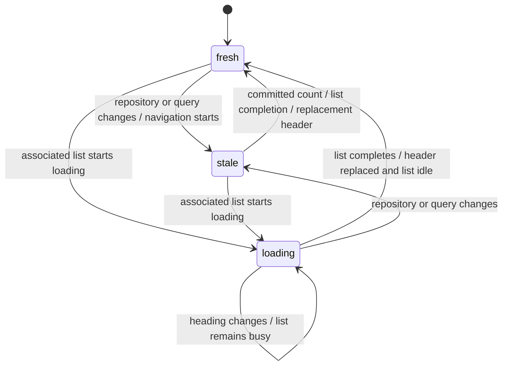

# Saved-view query model

GitHub owns search interpretation. A saved view stores a complete query string.
Selecting a view replaces the complete search with that string.
The extension does not merge lifecycle terms with the current search.
GitHub applies its own rules to the submitted query.

## Product contract

The repository pull-request menu includes an in-place editor for that repository's views.
The editor stages changes until the user selects **Save changes**.
The form replaces the view list in the same anchored panel.
Saving commits the complete view and any pending menu changes, then returns to the picker.
Saving does not change the current GitHub query or result count.
Back returns to the view list and keeps drafts in the current editing session.
Cancel changes discards the whole session after confirmation for meaningful changes.
An incomplete view blocks the complete save. The editor shows errors and focuses the first invalid field.
Empty new drafts disappear quietly on Back or Save. Existing views with empty fields remain incomplete drafts.
Only views for the current repository are active in this editor.
Older all-repository view data remains in storage and remains inactive.

Built-in queries use `is:pr` for type and `state:open` or `state:closed` for open or closed state.
Merge filters retain `is:merged` and `is:unmerged`. Draft filters retain `draft:true` and `draft:false`.
For example, **Needs review** uses `is:pr state:open draft:false review:required`.
Existing saved queries retain their original text. Both positive open and closed spellings remain recognizable.

The editor starts closed. New views start with empty name and query fields.
The query field shows an example as a placeholder.
Only an explicit save with a complete name and query persists the view.
Partial drafts remain in memory and do not survive a page reload or departure.

Empty or whitespace-only new drafts do not require discard confirmation.
Any name, description, or query text requires confirmation before discard. Clearing all text removes this requirement.
Existing views compare edits with their saved values. Restoring those values removes the confirmation requirement.
Browser navigation also requires confirmation for unsaved edits or pending writes.
Failed saves preserve the draft and its departure protection. Successful saves establish new saved values.

Only refreshed repository pull-request lists receive the menu.
Legacy controls remain native.
DOM and navigation signals coalesce in a microtask, so recognized replacement headers update before the next paint.
The controller does not defer this replacement with a timer.
Native controls remain available until a replacement can mount, including when the interactive script is unavailable.

### Picker layout

Picker rows use a uniform 44px minimum height, with or without a description.
Empty and whitespace-only descriptions do not create a second line. Name-only rows center the icon, label, and checkmark vertically.
The complete picker fits its content up to 560px, including its footer, within the available viewport space.
The picker opens above its trigger when that provides more space for its contents.
Long lists scroll while the footer stays visible. Edge shadows indicate more content above or below.
Keyboard navigation reveals the focused row inside the list.
Truncated descriptions reveal their complete text after 350ms of row hover or on keyboard focus.
The tooltip wraps within the viewport without changing row height and remains visible while the pointer is over it.
Escape dismisses the tooltip before the picker. Scrolling, selection, menu closure, and entry into the editor also dismiss it.
Descriptions that fit and views without descriptions do not show a tooltip.

### Visibility, deletion, and view templates

The **Show in menu** checkbox appears in the view list, where users compare visibility and order across views.
The editor header names the current repository without a scope qualifier. The checkbox column uses sentence case and has no redundant view heading.
The detailed editor defines the name, query, description, and icon.
For a hidden view, the detailed editor shows **Not shown in menu** with a **Manage visibility** link.
The link returns to the list and focuses that view's checkbox. It preserves unsaved edits and leaves visibility unchanged.
New views appear in the menu by default after saving.
Visibility changes use the same **Save changes** action as other edits.

Default views and custom views share the same controls. Their storage metadata does not change these controls.
**Delete view** stages deletion. **Undo** restores the latest deletion, including unsaved edits, visibility, and position.
Undo remains available until saving. Cancel changes restores all saved values.
**Add from templates…** appends independent copies without replacing existing views, separators, or order.
Equivalent queries identify existing views. Showing an existing hidden view requires an explicit action.
Starter selections remain reversible after Back. Edited copies become ordinary views and cannot be erased by unchecking a template.
The editor has no general reset action.

## Matching

The menu uses the current GitHub query to identify a saved view.
An existing selection keeps its identity while its query remains equivalent. Reordering equivalent views does not rename the current selection.
For a newly recognized search, an exact match takes priority over an alias match.
Hidden current views can retain their names in the trigger, but do not appear as temporary menu shortcuts.
The predicate registry defines canonical meanings, accepted spellings, and order groups.
Independent flat predicates can match in a different order.
Repeated predicates retain their relative order and count.
State and merge predicates share an order group because their interactions need more evidence.

The registry recognizes positive `is:pr`/`type:pr` and `is:open`/`state:open` aliases, including their issue and closed counterparts.
It also recognizes `is:draft`/`draft:true`.
The `state:draft` and `state:merged` aliases require isolation from other state, merge, and draft predicates.
If an isolation rule fails, the complete query requires an exact match.
Negative predicates retain their original spellings.
Frontend aliases such as `draft:yes` and sort shorthands do not establish server equivalence.

Grouped expressions retain their operators, whitespace, and branch order, with context-safe alias comparison.
Unknown predicates, unsupported enum values, free text, and malformed syntax require an exact match after outer whitespace removal.
Opaque values retain their quotes, escapes, case, commas, and ranges.
The registry does not infer an open state from a draft predicate or remove redundant terms.
An unmatched query appears as **Custom search**.
Matching never changes the saved query or the current query.

### External checks

Read-only checks on 2026-11-09 used the refreshed public `microsoft/vscode` PR page.
The fixed cohort used `created:2026-10-30`.
Six serial requests had at least 20 seconds between requests and received no rate-limit responses.
Both orders of `is:closed` and `is:unmerged` returned the same nine PRs.
Both orders of `state:open` and `state:draft` returned the same eight drafts.
The open/merged conflict responses omitted the result list and total count, so those checks remain inconclusive.
These observations do not establish general rules for negation, repeated filters, or other search surfaces.
The matcher keeps its conservative rules for those cases.
Unit and browser tests use local fixtures and do not request GitHub.

## Runtime state machines

Pure transitions own the runtime states and their valid events.
DOM changes, storage reads, confirmation dialogs, and writes remain in the browser adapters.

| Machine         | States                                    | Behavior                                                                                       |
| --------------- | ----------------------------------------- | ---------------------------------------------------------------------------------------------- |
| Content scope   | inactive, idle, loading, ready, failed    | Only the current repository and request ID can install its saved views.                        |
| Count freshness | fresh, stale, loading                     | Counts remain hidden during an associated list load, across observer callbacks.                |
| View editor     | closed, new, editing, with idle or saving | Pending writes reject edits. Failures preserve drafts. Save acknowledgments update the editor. |

Count identity contains the repository and the raw query.
A repository change invalidates the count even if the query stays the same.
An unrelated list completion cannot refresh the count.
A heading change cannot complete a pending list load.
A matching list completion can restore an unchanged count, including zero.

Repository view loads use request IDs to reject stale successes and failures.
Storage changes invalidate pending content loads.
The editor compares storage revisions before it writes staged changes.
An external change does not replace unsaved edits.
Read-only layouts reject writes before the editor calls storage.

## Storage and migration

Browser-local extension storage holds repository layouts.
Older global layouts remain untouched and inactive.
Migration preserves legacy lifecycle layouts and their order and visibility.
Unreadable, corrupt, or newer-format data remains intact and its affected layout is read-only.
Removing the extension can remove its local data.

## Code boundaries

- `saved-views.ts` owns saved-view definitions, selection, defaults, and migration.
- `query-predicates.ts` owns the predicate registry and comparison keys.
- `views-storage.ts` owns repository storage and revisions.
- `views-editor-state.ts` owns staged edits, discard decisions, saves, and conflict transitions. `views-editor.ts` renders the editor.
- `views-content-state.ts` owns repository loading and count freshness. `views-content.ts` adapts supported repository pages to the menu.
- `github-query.ts` supplies query syntax handling.
- The older query and layout modules remain for compatibility tests and legacy layout migration.

GitHub documents search syntax in its [issue and pull-request search documentation](https://docs.github.com/en/search-github/searching-on-github/searching-issues-and-pull-requests).
Its [advanced Boolean filtering documentation](https://docs.github.com/en/issues/tracking-your-work-with-issues/using-issues/filtering-and-searching-issues-and-pull-requests) describes Issues filters.
